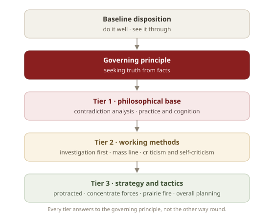
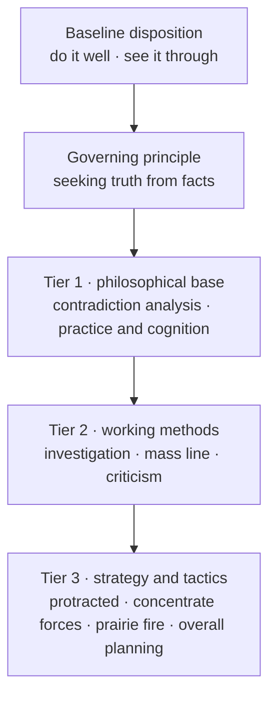

# Qiushi Methodology

<p align="center">
  
</p>

<p align="center">
  <a href="assets/preview/index.html"></a>
</p>

<p align="center"><strong><a href="assets/preview/index.html">Open the illustrated introduction →</a></strong><br>
double-click the file, or run <code>./scripts/open-preview.sh</code></p>

> Build agents that investigate first, focus on the main contradiction, validate in practice, and keep pushing until the work is actually done.

This package turns the upstream project into **one** Astravia skill. The market shows one card; the installed folder holds one entry text that states the governing principle and routes, plus ten method playbooks it reads on demand from its own `references/` folder. Nothing is duplicated into the panel, and nothing calls the network.

Every method is traceable to a source text — the quotations live in `references/skills/<name>/original-texts.md` and are never loaded unless asked for. Provenance, the licence and the per-file modification list are in `NOTICE.md`.

## Why This Exists

Many agents can generate text, but they still fail at disciplined work:

- they answer before collecting facts
- they scatter effort across too many tasks
- they stop at the first blocker
- they skip verification and call that "done"

This package is meant to correct that with one governing principle and nine concrete methods:

- `seeking truth from facts` as the governing principle
- contradiction analysis
- practice -> cognition -> practice iteration
- investigation first
- mass line feedback synthesis
- criticism and self-criticism
- protracted strategy
- concentrate forces
- spark a prairie fire
- overall planning

## What This Is Not

- **Not politics or propaganda.** It is methodology. Dialectical and practice-philosophy methods apply to any situation that needs a problem analysed and solved.
- **Not persona distillation.** A skill can carry a knowledge base and a workflow; it cannot and should not simulate a person. Any attempt at that ends in caricature.

*What is extracted here is method that has already been tested in practice, turned into executable cognitive tools.*

## How the Methods Fit Together

<p align="center">
  
</p>

<details>
<summary>Mermaid source</summary>



</details>

☀️ **Governing principle** — constrains every judgement

- **Seeking truth from facts**: start from the actual state of things; let evidence set the conclusion and let reality correct the theory. It is not a tenth weapon, it is the standard all the weapons answer to.

⚙️ **Tier 1 · philosophical base** — the frame for analysing any problem

- **⚔️ Contradiction analysis**: name the opposing sides, find the principal contradiction, classify its nature.
- **🔄 Practice and cognition**: practice → cognition → practice, spiralling upward.

🛠️ **Tier 2 · working methods** — the everyday habits

- **🔎 Investigation first**: no investigation, no right to speak.
- **👥 Mass line**: gather, systematise, take it back, verify, gather again.
- **🪞 Criticism and self-criticism**: cure the illness, save the patient; sweep the house regularly.

🎖️ **Tier 3 · strategy and tactics** — how to act on a concrete task

- **⏳ Protracted strategy**: contempt for the difficulty in strategy, full attention to it in tactics.
- **🎯 Concentrate forces**: one target destroyed beats ten targets wounded.
- **🔥 Spark a prairie fire**: build a foothold, do not roam.
- **⚖️ Overall planning**: mobilise every positive factor; refuse one-sidedness.

## The Nine Weapons

| Weapon | Core idea | Source text | Fits |
| --- | --- | --- | --- |
| ⚔️ Contradiction analysis | Find the principal contradiction | *On Contradiction* | Complex problem analysis |
| 🔄 Practice and cognition | Practice → cognition → practice | *On Practice* | Validating and iterating a plan |
| 🔎 Investigation first | No investigation, no right to speak | *Oppose Book Worship* | Gathering facts before deciding |
| 👥 Mass line | From the people, back to the people | *On the Methods of Leadership* | Synthesising feedback, sign-off |
| 🪞 Criticism and self-criticism | Cure the illness, save the patient | *On Coalition Government* | Reviewing work, quality repair |
| ⏳ Protracted strategy | Contempt in strategy, attention in tactics | *On Protracted War* | Long, hard tasks |
| 🎯 Concentrate forces | Concentrate, destroy in detail | *Problems of Strategy in China's Revolutionary War* | Priorities and focus |
| 🔥 Spark a prairie fire | Build a base area, do not roam | *A Single Spark Can Start a Prairie Fire* | Starting from nothing |
| ⚖️ Overall planning | Mobilise every positive factor | *On the Ten Major Relationships* | Balancing competing goals |

> `workflows` 🔗 is the orchestration layer: it fixes the order and the handoff artefacts for chains of methods.

## How to Use It

One card installs one skill entry. The entry `SKILL.md` is deliberately narrow — it does three things:

1. ☀️ enforce `seeking truth from facts` through four hard rules: claims follow evidence, separate fact / inference / unknown, verified means done, diagnose before giving up
2. 🧭 route to a downstream playbook only when it clearly helps; direct-execution tasks trigger nothing
3. 🛠️ defer to the host's own plan / review / todo flows when they exist

Every method playbook keeps only five sections: **use / don't use** (trigger boundary), **procedure** (concrete actions), **output template** (an observable artifact), **discipline** (hard constraints), and **handoff** (which method usually comes next). Quotations, lookup tables and stage indicators sit in sibling files and are loaded on demand.

On session-start injection: upstream ships a `SessionStart` hook that pushes the entry text into context before the first turn. The hook is included here (`hooks/`, with the injection path repointed from `skills/arming-thought/SKILL.md` to this package's root `SKILL.md`, which is that entry's replacement), and the Astravia host does have a `SessionStart` engine that reads hook configuration from `hooks/hooks.json`. What the host does **not** do is write that configuration for you at install time, so whether the injection fires depends on whether it scans the installed package as a hook source. If it does not, nothing is lost: the skill loads when you open it or when its description matches, and the entry text is the constraint from then on.

### Naming a method


Upstream ships ten slash-command entrypoints. The Astravia panel has no command directory, so the entry carries an alias table instead — **just say the name**:
/contradiction-analysis   ⚔️  contradiction analysis
/practice-cognition       🔄  practice and cognition
/investigation-first      🔎  investigation first
/mass-line                👥  mass line
/criticism-self-criticism 🪞  criticism and self-criticism
/protracted-strategy      ⏳  protracted strategy
/concentrate-forces       🎯  concentrate forces
/spark-prairie-fire       🔥  spark a prairie fire
/overall-planning         ⚖️  overall planning
/workflows                🔗  workflows
Slash form, bare slug (`mass-line`) and the Chinese name all resolve through the same table to `references/skills/<name>/SKILL.md`. There is one discipline: **read it, or it did not happen** — claiming to apply a method without reading its playbook is the failure mode this package exists to prevent.

The same ten entrypoints are also shipped as real slash-command files in `commands/`, one per method, for hosts that register a command directory (Claude Code, Cursor, OpenCode). They are inert in Astravia; `scripts/install-platforms.mjs` copies them where they are not.

## Supporting Files

**📜 Source texts (`original-texts.md`)** — one per method, complete quotations with chapter and year. Never auto-loaded, always available, so every method stays traceable.

**🤖 Sub-agents (`agents/`)** — role briefs for work that needs a second context. Claude Code auto-discovers sibling `agents/*.md`; Astravia does not scan a skill package for agents, so here they are briefs you read out and hand to a sub-task:

- `investigator.md` — read-only investigator returning a fact / inference / unknown ledger; dispatch several in parallel when one line of inquiry is not enough
- `self-critic.md` — fresh-context reviewer that looks only at artifacts, not at the author's narrative, and attaches evidence to each finding

**🗺️ Reference guides (sibling files)** — pulled in by the playbook that needs them:

- `contradiction-types-reference.md` — contradiction types at a glance
- `review-checklist.md` — review checklist
- `phase-assessment-guide.md` — protracted-strategy stage assessment

## Project Layout

```text
qiushi-skill/
├── SKILL.md                                   # entry: principle + routing table + alias map
├── PLATFORMS.md  PLATFORMS.zh.md              # per-host install map (no upstream channels)
├── references/
│   ├── skills/.ignore                         # keeps the ten playbooks out of the panel
│   ├── skills/investigation-first/             # SKILL.md + original-texts.md
│   ├── skills/contradiction-analysis/          # + contradiction-types-reference.md
│   ├── skills/practice-cognition/
│   ├── skills/mass-line/
│   ├── skills/criticism-self-criticism/        # + review-checklist.md
│   ├── skills/protracted-strategy/             # + phase-assessment-guide.md
│   ├── skills/concentrate-forces/
│   ├── skills/spark-prairie-fire/
│   ├── skills/overall-planning/
│   ├── skills/workflows/
│   └── cases/tangping-editorial-perspective.md # the method applied to a real dispute (third party)
├── hooks/                                     # SessionStart: hooks.json, session-start(.ps1), run-hook.cmd
├── commands/                                  # ten slash-command templates, for hosts that have them
├── agents/                                    # investigator.md, self-critic.md (role briefs)
├── assets/
│   ├── icon.png  logo.png                     # market icon, wordmark (official upstream art)
│   ├── diagram/method-structure*.svg          # the structure chart shown above
│   └── preview/index.html                     # offline illustrated intro (images inlined)
├── scripts/                                   # open the page / checks / upstream sync / platform copy
├── tests/                                     # package tests (source repo; excluded from distribution)
├── ability.json  detail.json  detail.zh.json  # market presentation
├── scripts/upstream.json                      # provenance: repo, commit, per-file mapping
├── NOTICE.md  LICENSE
└── README.md  README.zh.md
```

The ten playbooks keep the upstream filename, `SKILL.md`, and are byte-identical to upstream. That filename is also what the host looks for when it discovers skills: it walks the installed folder recursively and turns every `SKILL.md` it finds into its own panel entry. `references/skills/.ignore` stops that walk at these ten files (`*/SKILL.md`), so the panel shows one entry instead of eleven. The host reads `.gitignore` / `.ignore` / `.fdignore` at every level and prefixes each rule with that folder, which is why a one-line file is enough. `.ignore` is used rather than `.gitignore` because a `.gitignore` there would also make git stop tracking the playbooks. Why not eleven skills is argued in `docs/adr/qiushi-skill/0004-single-skill-with-internal-routing.md`; the filename and ledger decisions are in `0007`.

## Install

Add this marketplace in Astravia (Skills → Add source), then install the card:

1. search for "Qiushi Methodology" in the market and install it
2. the package lands in `~/.astravia/skills/qiushi-skill/` and one entry appears in the skill panel; nothing to configure per method
3. it works offline — the playbooks are plain Markdown inside the installed folder and never call the network

### Other hosts, one command

Astravia is not the only host. The package carries the same layout every file-based agent understands, so one script places it where each one looks:

```bash
node scripts/install-platforms.mjs --list                  # what is detected, and where it would go
node scripts/install-platforms.mjs --target claude-code    # Claude Code
node scripts/install-platforms.mjs --target codex          # Codex (~/.codex, or $CODEX_HOME)
node scripts/install-platforms.mjs --target cursor --dest <folder>
node scripts/install-platforms.mjs --uninstall --target codex
```

For Claude Code the copy also carries `.claude-plugin/marketplace.json`; the script prints the two slash commands that finish the install (`/plugin marketplace add <folder>`, `/plugin install qiushi-skill@qiushi-skill`). Everything is copied from what is already on disk — no `npx`, no registry, no network. See [PLATFORMS.md](PLATFORMS.md) for the full target table.

## Checking It Locally

```bash
node scripts/verify-package.mjs         # routing, links, hooks, commands, ledger, isolation
node --test tests/*.test.mjs            # package tests: structure, metadata, page, ledger (source repo)
node scripts/sync-upstream.mjs --verify  # byte-level fidelity, no clone
./scripts/open-preview.sh               # the illustrated intro page
node scripts/install-platforms.mjs --list # which other hosts are detected, and where they would go
```

## Upstream Sync

- Pinned upstream revision: `5ace7173b2d71fa7848c56a29f74b39d611c6cb3` (version `2.0.0`).
- The ten playbooks and the twelve reference files are byte-identical to upstream. The entry `SKILL.md` differs only where `NOTICE.md` lists: frontmatter `name` / `version` / `description`, routing targets, and the added "how to read these" section that defines `$SKILL` and maps upstream identifiers (the `arming-thought` entry, slash commands, bare slugs) onto package paths.
- Check the claim, do not trust it: `node scripts/sync-upstream.mjs --verify` fetches each mapped file at the pinned commit — no clone, no git — and exits non-zero on any difference. An existing checkout can be used instead with `--upstream <dir>`. It skips the adapted entry by default (`--include-entry` compares it too).
- To update: run `node scripts/sync-upstream.mjs --sync` (it never overwrites the adapted entry), bump the `version` fields and `upstream.json.revision` / `.version`, then run `node scripts/marketplace.mjs check`, `node scripts/marketplace.mjs build`, `node --test tests/*.test.mjs` and, inside the package, `node scripts/verify-package.mjs`.

## Using It in Other Hosts

The ten playbooks are ordinary skill folders — each one carries its own `SKILL.md` — so any host that reads a skill directory can use them. `scripts/install-platforms.mjs` copies the set to the directory each host expects, keeps a `.qiushi-skill-install.json` ledger, and removes only what it wrote:

```bash
node scripts/install-platforms.mjs --list                     # detect hosts, show target paths
node scripts/install-platforms.mjs --target codex             # copy into ~/.codex/skills
node scripts/install-platforms.mjs --target claude-code --scope project
node scripts/install-platforms.mjs --uninstall --target codex
```

`PLATFORMS.md` has the per-host table, the hook story, and the manual `cp -R` fallback. `commands/` goes along for hosts that register slash commands; Astravia does not, and uses the alias table above instead.

The upstream `bin/` installer is **not** shipped: it resolves an `npx` package name and a GitHub coordinate, neither of which exists here. Its copy-and-ledger behaviour is what the script above reimplements, without the network.

## Inspiration

- [obra/superpowers](https://github.com/obra/superpowers) — agentic skills framework and software development methodology
- The selected works of Mao Zedong (volumes 1–5) — the methodological root of this project

## A Note on Quotations

Every quotation and method in this package comes from publicly published material, cited with title and year, and is kept as faithful to the original sense as possible. The purpose is methodology research and application only.

## License

MIT, Copyright (c) 2026 qiushi-skills contributors. See `LICENSE` and `NOTICE.md`.
