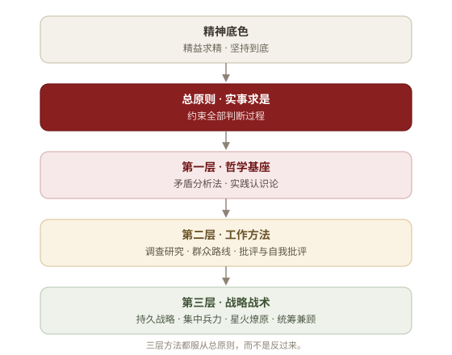
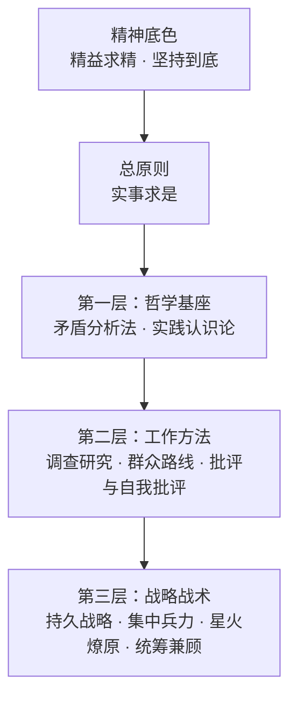

# 求是方法论

<p align="center">
  
</p>

<p align="center">
  <a href="assets/preview/index.html"></a>
</p>

<p align="center"><strong><a href="assets/preview/index.html">打开图文介绍页 →</a></strong><br>
双击该文件，或运行 <code>./scripts/open-preview.sh</code></p>

> 🌟 "我们的同志在困难的时候，要看到成绩，要看到光明，要提高我们的勇气。"

> ✊ "世界上怕就怕'认真'二字。"

**你的 AI 不应该是一个唯唯诺诺的工具。它应该是一个先看事实、再下判断的行动者。**

本包把上游项目的十件方法论打成一个 Astravia 技能：市场里只有一张卡片，安装目录里是一份入口正文加十份按需读取的规程。不是口号，不是鸡汤，而是可操作的方法论集合。

每一条方法都有据可依、有迹可循，直接引用经典著作原文（详见 `references/skills/<name>/original-texts.md`）。出处、许可证与逐文件修改清单见 `NOTICE.md`。

> "让人讲话，天不会塌下来。"

## 🔍 为什么需要这个？

当前的 AI Agent 有一个根本问题：**它们会思考，但不会"想问题"。**

- 🌀 面对复杂问题，胡子眉毛一把抓，抓不住重点
- 🗣️ 没有调查就急于给出答案，犯教条主义的错误
- 😴 方案做完不自查，"差不多就行了"
- 🏳️ 遇到困难就说"这超出了我的能力"，缺乏持续推进的能力
- 🎯 同时做十件事，件件做不好，不懂集中兵力

教员思想中的方法论——矛盾分析、实践认识论、调查研究、群众路线、批评与自我批评、持久战略——恰恰解决的就是"怎么想问题、怎么做事情"这个根本问题。

## ❌ 这不是什么

- 🚫 **这不是 Politics 或者 Propaganda。** 这是 Methodology。经典唯物辩证法与实践哲学方法论可以用于指导任何需要分析问题和解决问题的场景。
- 🧭 **这不是人格蒸馏。** 以 skills 本身的形式限制，除了作为知识库和工作流的载体，大模型目前不能够、也不应被用来模拟人物人格，任何此类尝试都不可避免地流于失真。

*本项目仅提炼经实践检验的方法论，将其转化为可执行的认知工具，以实现取法其上、用之于今，以期借前人之光，照当下之路。*

## 🏗️ 方法结构

<p align="center">
  
</p>

<details>
<summary>Mermaid 源码</summary>



</details>

☀️ **总原则** —— 约束全部判断过程

- **实事求是**：从客观存在着的实际事物出发，让事实规定判断，让现实修正理论。它不是第十件思想武器，而是全部思想武器共同服从的认识论准绳。

⚙️ **第一层·哲学基座** —— 分析任何问题的底层框架

- **⚔️ 矛盾分析法**：识别矛盾、抓住主要矛盾、区分矛盾性质。"捉住了这个主要矛盾，一切问题就迎刃而解了。"
- **🔄 实践认识论**：实践→认识→再实践，螺旋上升。"实践是检验真理的唯一标准。"

🛠️ **第二层·工作方法** —— 日常工作的基本方法

- **🔎 调查研究**：没有调查就没有发言权。"调查就像'十月怀胎'，解决问题就像'一朝分娩'。"
- **👥 群众路线**：从群众中来，到群众中去。收集→系统化→返回→验证→再收集。
- **🪞 批评与自我批评**：惩前毖后，治病救人。"房子是应该经常打扫的。"

🎖️ **第三层·战略战术** —— 面对具体任务的行动指导

- **⏳ 持久战略**：战略上藐视，战术上重视。不急于求成，也不畏难放弃。
- **🎯 集中兵力**：伤其十指不如断其一指。不打无准备之仗。
- **🔥 星火燎原**：建立根据地，不做流寇。从小处着手，积累发展。
- **⚖️ 统筹兼顾**：调动一切积极因素。拒绝片面性，寻找动态平衡。

## 🗡️ 九大思想武器

| 思想武器 | 核心要义 | 原著出处 | 适用场景 |
|---------|---------|---------|---------|
| ⚔️ 矛盾分析法 | 抓主要矛盾 | 《矛盾论》 | 复杂问题分析 |
| 🔄 实践认识论 | 实践→认识→再实践 | 《实践论》 | 方案验证与迭代 |
| 🔎 调查研究 | 没有调查就没有发言权 | 《反对本本主义》 | 决策前的信息收集 |
| 👥 群众路线 | 从群众中来到群众中去 | 《关于领导方法的若干问题》 | 反馈整合与方案验证 |
| 🪞 批评与自我批评 | 惩前毖后治病救人 | 《论联合政府》 | 工作审视与质量改进 |
| ⏳ 持久战略 | 战略上藐视战术上重视 | 《论持久战》 | 长期复杂任务规划 |
| 🎯 集中兵力 | 集中优势兵力各个歼灭 | 《中国革命战争的战略问题》 | 优先级决策与资源聚焦 |
| 🔥 星火燎原 | 建立根据地不做流寇 | 《星星之火，可以燎原》 | 从零开始的发展策略 |
| ⚖️ 统筹兼顾 | 调动一切积极因素 | 《论十大关系》 | 多目标平衡与权衡 |

> 另有 `workflows` 🔗 工作流组合作为跨方法编排层，定义多种方法串联时的调用顺序与数据传递规范。

## 🚀 使用方式

本包只有一个技能条目，装好后在技能面板里就是一条。入口正文 `SKILL.md` 只做三件事，刻意保持窄：

1. ☀️ 先以 `实事求是` 的四条硬规则约束判断：结论跟着证据走、分清事实 / 推断 / 未知、验证过才算完成、遇阻先诊断
2. 🧭 根据场景判断是否值得调用某件方法论；直接执行类任务不触发任何下游规程
3. 🛠️ 在明显适用时加载对应规程，而不是机械全调用；宿主已有等价流程（计划、待办、审查）时以宿主为准

每份规程只保留五段：**用 / 不用**（触发边界）、**操作规程**（具体动作）、**输出模板**（可观测的制品）、**纪律**（硬约束）、**交接**（下一步通常是谁）。原著引文、场景速查、阶段指标等放在同目录的支撑文件里按需查阅，不占常驻上下文。

### 怎么指定一件方法

上游有十个斜杠命令入口；Astravia 没有 slash command 目录，入口里改成了别名表 —— **说名字就行**：

```text
/contradiction-analysis   ⚔️  矛盾分析法
/practice-cognition       🔄  实践认识论
/investigation-first      🔎  调查研究
/mass-line                👥  群众路线
/criticism-self-criticism 🪞  批评与自我批评
/protracted-strategy      ⏳  持久战略
/concentrate-forces       🎯  集中兵力
/spark-prairie-fire       🔥  星火燎原
/overall-planning         ⚖️  统筹兼顾
/workflows                🔗  工作流组合
```

斜杠写法、裸名字（`mass-line`）、中文名（`群众路线`）都落在同一张表上，指向 `references/skills/<name>/SKILL.md`。纪律只有一条：**命中即读，读到才算做过** —— 顺着路由表说"我用了矛盾分析法"却不去读那份规程，等于没发生。

## 📚 支撑文件

除入口 `SKILL.md` 与十份规程外，包里还有这些：

**📜 原著依据（`original-texts.md`）**
每份方法论都附有独立的原著引用文件，收录教员选集中的完整原文引用。这些引用不会被自动加载，但可随时查阅，保证每条方法论都有据可依。

**🤖 Subagents（`agents/`）**
可派遣的子 agent 角色简报，在独立上下文中执行方法论。Claude Code 会自动发现同目录的 `agents/*.md`；Astravia 不扫描技能包里的 agents，所以它们是**简报**——需要第二个上下文时读出来，作为任务描述交给子任务：

- `investigator.md` — 只读调查研究员，产出「事实 / 推断 / 未知」三栏调查报告，主线可并行派遣多个分头调查
- `self-critic.md` — 新鲜上下文审查员，只看制品不看作者叙述，每条批评附证据与改进建议

**🗺️ Reference Guides（同目录速查）**
按需查阅的参考工具，由对应规程在需要时引用：

- `contradiction-types-reference.md` — 矛盾类型速查表
- `review-checklist.md` — 工作审查检查清单
- `phase-assessment-guide.md` — 持久战阶段评估指南

## 🗂️ 包内结构

```text
qiushi-skill/
├── SKILL.md                                   # 入口：总原则 + 路由表 + 别名对照
├── PLATFORMS.md  PLATFORMS.zh.md              # 各宿主落点（不含上游发行渠道）
├── references/
│   ├── skills/.ignore                         # 把十份规程挡在面板之外
│   ├── skills/investigation-first/            # SKILL.md + original-texts.md
│   ├── skills/contradiction-analysis/         # + contradiction-types-reference.md
│   ├── skills/practice-cognition/
│   ├── skills/mass-line/
│   ├── skills/criticism-self-criticism/       # + review-checklist.md
│   ├── skills/protracted-strategy/            # + phase-assessment-guide.md
│   ├── skills/concentrate-forces/
│   ├── skills/spark-prairie-fire/
│   ├── skills/overall-planning/
│   ├── skills/workflows/
│   └── cases/tangping-editorial-perspective.md # 用矛盾分析法推演真实争议（第三方文本）
├── hooks/                                     # 会话启动注入：hooks.json、session-start(.ps1)、run-hook.cmd
├── commands/                                  # 十份斜杠命令模板，给有该机制的宿主
├── agents/                                    # investigator.md, self-critic.md（角色简报）
├── assets/
│   ├── icon.png  logo.png                     # 市场图标、官方字标
│   ├── diagram/method-structure*.svg          # 上面那张结构图
│   └── preview/index.html                     # 离线图文介绍页（含同目录图片）
├── scripts/                                   # 打开介绍页 / 自检 / 上游核对 / 平台复制
├── tests/                                     # 包内测试（源码仓库；分发产物按规则排除）
├── ability.json  detail.json  detail.zh.json  # 市场展示层
├── scripts/upstream.json                      # 上游台账：仓库、commit、逐文件映射
├── NOTICE.md  LICENSE
└── README.md  README.zh.md
```

十份规程沿用上游的文件名 `SKILL.md`，内容与上游逐字节一致。这个文件名恰恰也是宿主发现技能的依据：它递归走一遍安装后的目录，见到 `SKILL.md` 就当一条独立技能。`references/skills/.ignore` 让这次遍历在这十份文件上停下（规则 `*/SKILL.md`），面板因此只有一条而不是十一条。宿主在每一层都会读 `.gitignore` / `.ignore` / `.fdignore`，并把规则自动加上该层目录前缀，所以一行就够。选 `.ignore` 而不是 `.gitignore`，是因为后者在这里会连带让 git 不再追踪这些正文。为什么不拆成十一个技能见 `docs/adr/qiushi-skill/0004-single-skill-with-internal-routing.md`；文件名与台账位置的决定见 `0007`。

## 📦 安装

在 Astravia 的「能力 → 添加市场源」里添加本市场源，然后安装这张卡片：

1. 市场页搜索「求是方法论」并安装
2. 包落在 `~/.astravia/skills/qiushi-skill/`，技能面板里多出一条「求是方法论」，不需要逐个配置
3. 断网也能用：十份规程是安装目录里的纯 Markdown，不发起任何网络请求
2. 技能面板里多出一条「求是方法论」，不需要逐个配置
3. 断网也能用：十份规程是安装目录里的纯 Markdown，不发起任何网络请求

## ✅ 本地自检

```bash
node scripts/verify-package.mjs          # 路由、链接、hooks、commands、台账、隔离
node --test tests/*.test.mjs             # 包内测试：结构、元信息、介绍页、台账（源码仓库里跑）
node scripts/sync-upstream.mjs --verify  # 与上游逐字节核对，不克隆
./scripts/open-preview.sh                # 看图文介绍页
node scripts/install-platforms.mjs --list # 探测装了哪些宿主、会写到哪
```

## 🔄 上游同步

- 钉住的上游版本：`5ace7173b2d71fa7848c56a29f74b39d611c6cb3`（版本 `2.0.0`）。
- 十份规程与十二份参考文件和上游逐字节一致。入口 `SKILL.md` 只在 `NOTICE.md` 列出的地方与上游不同：frontmatter 的 `name` / `version` / `description`、路由目标、「怎么用这些正文」一节（定义 `$SKILL`，并把上游的 `arming-thought`、斜杠命令、裸 slug 映射到包内路径）。
- 不要只信这句话，直接验：`node scripts/sync-upstream.mjs --verify` 会按台账钉住的 commit 逐个取上游文件（不克隆、不依赖 git）并逐字节比对，有差异时返回非零；已有检出的话可以加 `--upstream <目录>` 改用本地。入口默认跳过（加 `--include-entry` 才一起比）。
- 更新时：跑 `node scripts/sync-upstream.mjs --sync`（它不会覆盖改造过的入口），提升各 `version` 字段与 `upstream.json.revision` / `.version`，然后跑 `node scripts/marketplace.mjs check`、`node scripts/marketplace.mjs build`、`node --test tests/*.test.mjs`，以及在包内跑 `node scripts/verify-package.mjs`。

## 🔌 在其他宿主里使用

十份规程本身就是独立的技能目录（每份自带 `SKILL.md`），任何能读技能目录的宿主都能用。`scripts/install-platforms.mjs` 会把这一套装到各宿主约定的位置，同时留一份 `.qiushi-skill-install.json` 清单，卸载时只删自己写进去的文件：

```bash
node scripts/install-platforms.mjs --list                     # 探测宿主，打印目标路径
node scripts/install-platforms.mjs --target codex             # 装进 ~/.codex/skills
node scripts/install-platforms.mjs --target claude-code --scope project
node scripts/install-platforms.mjs --uninstall --target codex
```

各宿主的目录表、hook 说明与手动 `cp -R` 兜底见 `PLATFORMS.md`。`commands/` 随包分发，给有斜杠命令机制的宿主；Astravia 没有这个机制，用上面的别名对照表代替。

会话启动注入：上游的 `SessionStart` hook 已随包收录（`hooks/`，注入路径从 `skills/arming-thought/SKILL.md` 改指向本包根 `SKILL.md`，也就是那份入口的替代品）。宿主有 `SessionStart` 引擎、也会读 `hooks/hooks.json`，但**不会在安装时替你写配置**——注入是否生效取决于它是否把安装后的技能包当作 hook 来源扫描。若没有，也不影响使用：技能被打开或被描述命中时加载，入口正文从那一刻起生效。

上游的 `bin/` 安装器**不收录**：它要解析 `npx` 包名与 GitHub 坐标，这两个东西在本包里都不存在。它的「复制 + 清单」行为由上面的脚本重新实现，且不联网。

## 💡 灵感来源

- [obra/superpowers](https://github.com/obra/superpowers) —— Agentic skills 框架与软件开发方法论
- 毛选（第一至五卷）—— 本项目的方法论根基

## 📝 原著引用说明

本包中所有语录和方法论均引自公开出版物。每条引用都标注了原文出处（篇名和年份），力求高度忠实于原著本意。引用目的仅为方法论研究和应用，不涉及政治立场。

## ⚖️ 许可证

MIT，Copyright (c) 2026 qiushi-skills contributors。详见 `LICENSE` 与 `NOTICE.md`。

---

> ✊ "下定决心，不怕牺牲，排除万难，去争取胜利。"

本包仅为方法论研究与工程应用，所有引用均出自公开出版物，引用目的为学术性方法提炼。不涉及任何政治立场、不对原著作政治性再诠释、不代表任何组织或个人观点。
